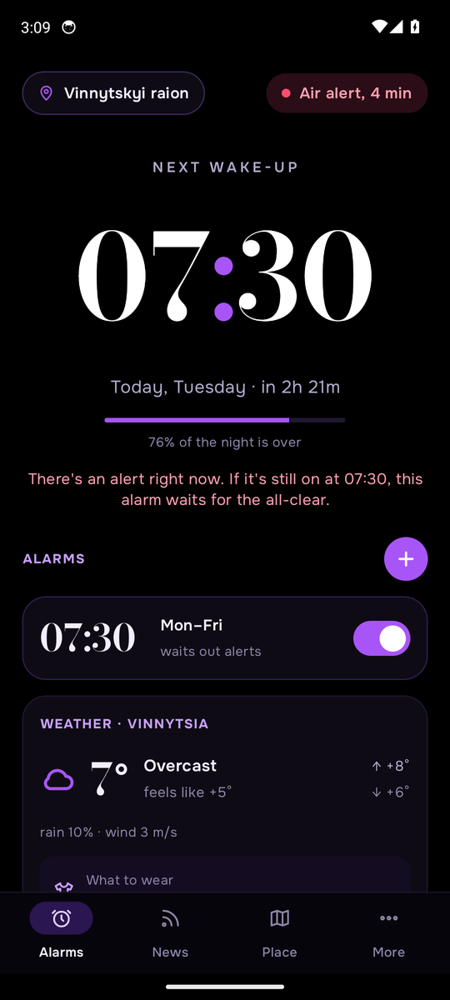
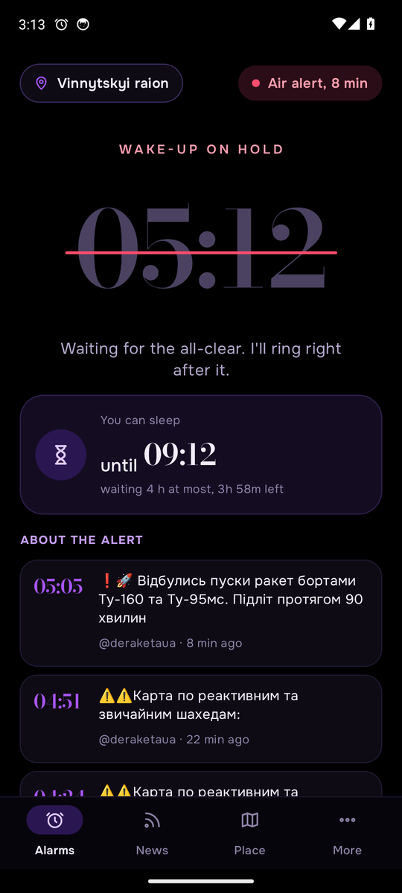
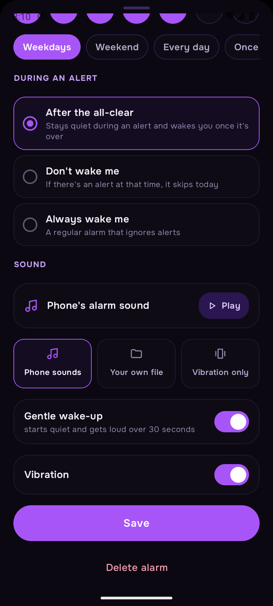
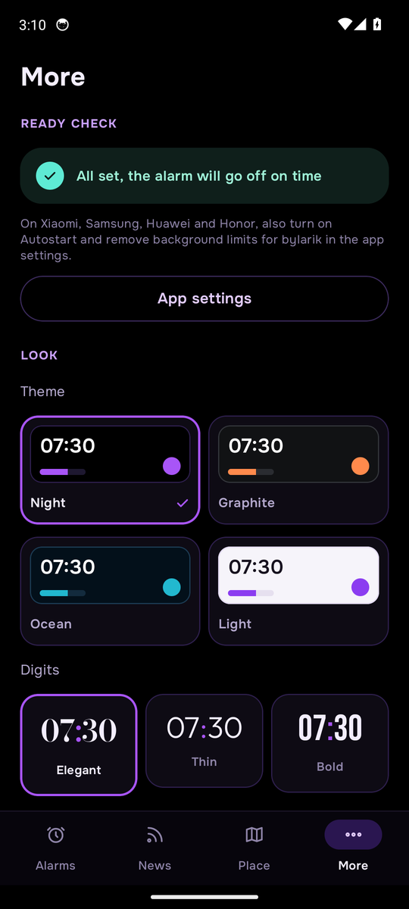
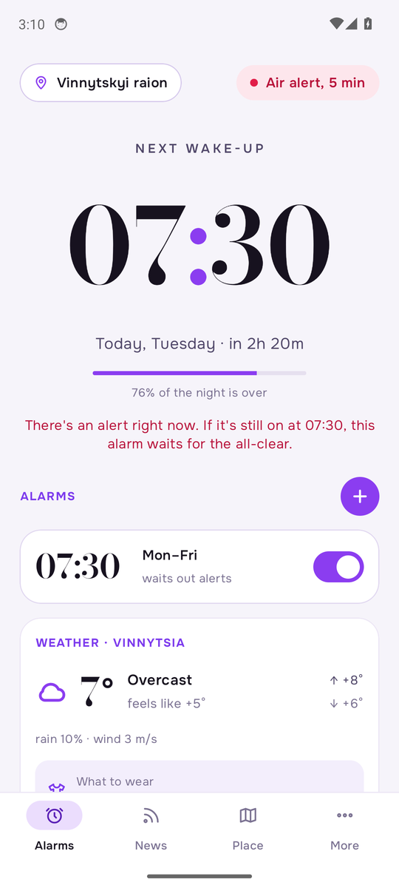

# bylarik

An Android alarm clock that knows about air-raid alerts in Ukraine.

If there's an alert in your area when your alarm is due, bylarik doesn't wake you up for nothing. It waits for the all-clear and rings then, or stays silent for the day, whichever you choose for that alarm. If there's no alert, it's just a regular alarm clock.

<p align="center">
  
  
  
</p>

<p align="center">
  
  
  
</p>

## Features

- **Three rules per alarm** for when an alert is on:
  - *After the all-clear* waits and rings as soon as the alert ends.
  - *Don't wake me* skips the alarm for that day.
  - *Always wake me* ignores alerts.
- **Your exact area.** Pick an oblast, a district or a community. Since December 2025 alerts are declared per district, so this matters.
- **A safe default.** If the alert data can't be reached at all, the alarm rings anyway.
- **Backup data source.** If the main source is down, bylarik uses a second one before giving up.
- **Sounds.** Choose a sound for each alarm: one of the phone's sounds, your own audio file or vibration only. You can preview it, and the volume can rise gently or start at full.
- **Weather and what to wear.** The forecast for your oblast's main city and a short clothing tip, both on the main screen and on the ringing screen.
- **Telegram news.** Posts from public monitoring channels, filtered down to the ones about alerts. They're for information only; the decision to wake you never depends on them.
- **Four themes** (Night, Graphite, Ocean, Light) and three styles of large digits.
- **Your language.** Ukrainian, Russian or English, following the phone's language. On Android 13+ you can also set it under Settings → Apps → bylarik → Language.
- **Self-updating.** The app checks this repository's releases and offers new versions. Your settings stay as they are.

## Install

1. On your phone, open the [latest release](https://github.com/1larik1/bylarik/releases/latest) and download `bylarik.apk`.
2. Open the file and allow your browser or file manager to install apps when Android asks.
3. Android or Google Play Protect may warn that the app is from an unknown developer. That's because it doesn't come from Google Play. Tap **Install anyway**, or **More details → Install anyway**. All of the code is in this repository.
4. Open bylarik, pick your area and go to **More → Ready check** to grant the permissions.
5. Tap **Test alarm in one minute** to check that everything works on your phone.

On Xiaomi, Samsung, Huawei and Honor phones, also turn on **Autostart** and remove background limits for bylarik in the app's system settings. These phones are known for putting background apps to sleep.

Requires Android 8.0 or newer.

## Permissions

| Permission | Why |
|---|---|
| Notifications | Shows the ringing alarm with Dismiss and Snooze, and the "waiting for the all-clear" status |
| Alarms & reminders | Rings at the exact minute, even in deep sleep |
| Full-screen alarm | Shows the alarm screen over the lock screen |
| No battery restrictions | Lets the app keep checking while it waits for the all-clear at night |
| Install apps | Installs updates from this repository (Android asks you to confirm each one) |
| Uninstall apps | Lets the **Uninstall app** button in More remove bylarik |
| Internet | Fetches alert data, weather, Telegram posts and updates |

bylarik doesn't ask for your location, contacts, files (other than the sound file you pick), camera or microphone.

## How it decides

When an alarm is due, bylarik checks the official air-raid alert status for your area:

1. **Main source:** [siren.pp.ua](https://siren.pp.ua), a public mirror of the official `api.ukrainealarm.com` data, down to districts and communities.
2. **Backup source:** [vadimklimenko.com](https://vadimklimenko.com/map/statuses.json), at oblast and district level.
3. **If neither answers**, it rings just in case.

While it waits for the all-clear, it checks every 20 seconds (or once a minute with **Battery saver** on). It rings when the alert ends, after an optional delay of 5 to 30 minutes. It also rings once the maximum wait you set has passed (4 hours by default).

Weather comes from [Open-Meteo](https://open-meteo.com) for the main city of your oblast. No account or key is needed, and your location isn't used.

## Battery

- When no alarm is ringing or waiting, bylarik does nothing in the background. The alarm time is kept by Android itself.
- Alert data, news and weather refresh only while the app is open on screen.
- The only noticeable use is while an alarm waits for the all-clear: a request every 20 seconds and a partial wake lock, for at most the wait time you set. **Battery saver** cuts the number of requests to a third.

## Privacy

There are no accounts, no analytics and no ads. The app talks only to the services listed above and to GitHub for updates. Your settings stay on your phone.

## Updates

Every push to `android/` goes through this pipeline in GitHub Actions:

1. Build the app and run the unit tests.
2. Install it on an Android 14 emulator and test it like a person would. The test picks an area, walks through the screens in all three languages and switches all four themes. It also sets a test alarm with the screen locked and checks that it rings, or waits for the all-clear if an alert is on.
3. Only if that passes, publish a new [release](https://github.com/1larik1/bylarik/releases).
4. Install the previous version on an emulator and check that it updates itself to the new one.

The app checks for updates when you open it (at most once an hour) and in the morning after an alarm. When there's a new version, it shows a notification.

## Building

```bash
cd android
gradle assembleRelease          # needs JDK 17 and the Android SDK (compileSdk 35)
gradle testReleaseUnitTest      # unit tests; LiveApiTest also pings the real data sources
```

The app is written in Kotlin with Jetpack Compose. It has no third-party dependencies apart from AndroidX and jsoup.

```
android/app/src/main/java/ua/otboi/app/
  alarm/    scheduling, the foreground service that checks alerts and waits, ringing
  data/     settings and storage, places, weather and clothing advice
  net/      alert sources, Telegram reader, HTTP
  i18n/     all UI text in Ukrainian, Russian and English
  ui/       screens, themes, components
  update/   self-update from GitHub releases
android/ci/smoke.py   the emulator test
```

The package name is `ua.otboi.app` for historical reasons: the app was called "Otboi" before it became bylarik. Changing the package would break updates for existing installs.

## Changelog

See [CHANGELOG.md](CHANGELOG.md).
